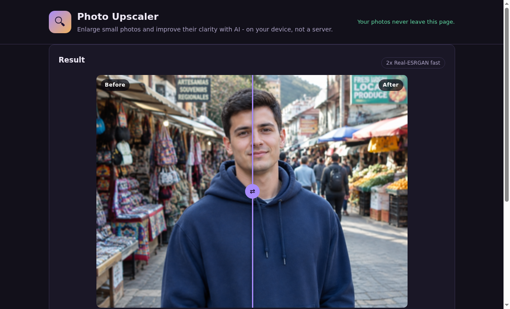

# Photo Upscaler

Enlarge small photos and improve their clarity with AI - on your device, not a server. No account, no upload, no paywall.



## Why this exists

Tools like Remini and Topaz charge for upscaling, and every photo you try goes to someone else's server. This tool does the job locally: the AI model downloads to your browser once, and your photos never leave your device.

## What it does

- Drop, choose, or paste a photo (JPG, PNG, WebP), up to 1600px on the long side.
- Pick 2x or 4x enlargement.
- Pick Fast (smaller download) or High quality (better detail, ~3 MB model).
- Compare before/after with a labeled slider.
- Download the result as a PNG at the exact enlarged size.

## The AI behind it

Real-ESRGAN super-resolution models ([UpscalerJS ESRGAN slim and medium](https://github.com/thekevinscott/UpscalerJS), MIT license), running in your browser through [TensorFlow.js](https://www.tensorflow.org/js) (Apache-2.0) with WebGL. No Python, no server, no API key.

Honest limits:

- The AI invents plausible new detail to fill the extra pixels. It cannot recover true detail that was lost from the original photo.
- Best on photos that are small or softly compressed. It is a general photo model, not a face-restoration model.
- The first visit downloads about 1.2 MB (runtime plus the Fast 2x model), measured on a fresh browser. High-quality models add about 3 MB, downloaded only if you pick that mode. Your browser caches everything, so later visits are faster. The page code and models load from a CDN on first visit; your photos are never uploaded anywhere.
- Processing time depends on your device: seconds with a GPU, longer on CPU-only devices.

## Run it

**Easiest:** open `upscaler.html` - a standalone single-file build that runs by double-clicking, no server needed (it loads the AI runtime and models from a CDN, so the first run needs internet).

**From source (the modular files):** serve the folder over HTTP, because browsers block loading separate ES modules from `file://`:

```bash
# from this folder, pick one:
npx serve .
python3 -m http.server 8000
```

Then open the printed local address (for example `http://localhost:8000`).

It also works hosted on any static host - GitHub Pages, Netlify, Cloudflare Pages - with zero configuration and zero server costs, because there is no backend.

## Tech

Plain HTML, CSS, and JavaScript. The only dependency is TensorFlow.js, pinned and loaded from a CDN. The ESRGAN models run through a small custom tiling loop (96px tiles with overlap) so large photos fit in memory. No tracking, no analytics, no cookies.

```text
upscaler/
├── README.md
├── LICENSE
├── NOTICE
├── upscaler.html   <- standalone single-file build
├── index.html      <- modular source
├── styles.css
└── app.js
```
